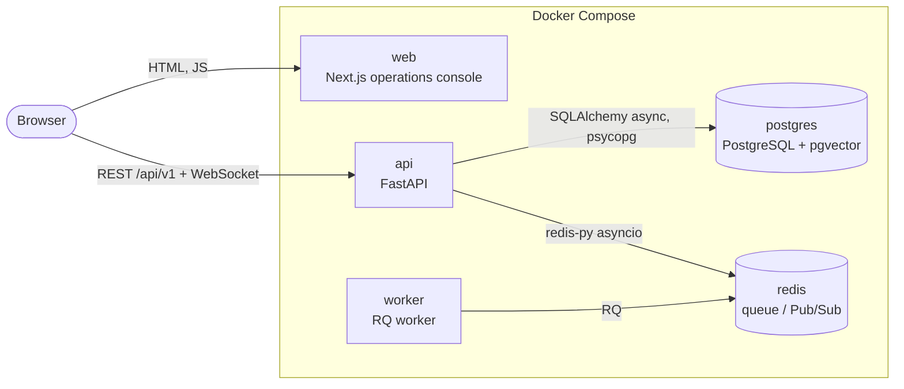
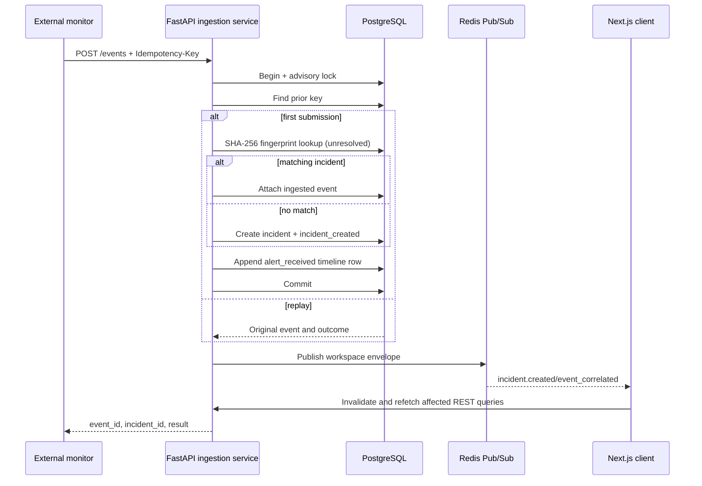

# OpsPilot AI - Architecture (Module 1)

## Container view

## Responsibilities

| Container | Responsibility in Module 0 |
| --- | --- |
| **web** | Serves the incident dashboard, list, detail, creation, and service settings. TanStack Query owns server state; a reconnecting WebSocket invalidates affected caches. |
| **api** | Versioned REST/WebSocket API, health endpoints, tenant-scoped incident application services, structured logging, and PostgreSQL/Redis lifecycles. |
| **worker** | Runs RQ jobs from the `default` queue. Only a `ping` smoke-test job exists. Same image and settings as the API. |
| **postgres** | System of record for workspaces, services, incidents, append-only timeline events, and ingested events. Alembic is the only schema writer. |
| **pgvector** | PostgreSQL extension enabled by migration `0001`, reserved for later embedding storage. No vector columns exist yet. |
| **redis** | RQ backend and workspace-isolated incident Pub/Sub channels. Persisted with AOF to a named volume. |

## Readiness request flow

1. The browser loads `/` from **web**; the page validates `NEXT_PUBLIC_API_BASE_URL`, then renders the dashboard.
2. The dashboard calls `GET {API}/health/ready` on load, every 10 s, and on "Refresh".
3. **api** probes PostgreSQL (`SELECT 1`) and Redis (`PING`) concurrently, each under `DEPENDENCY_TIMEOUT_SECONDS`.
4. Both up: HTTP 200 `{"status":"ready", ...}`. Any down: HTTP 503 `{"status":"degraded", ...}` with per-dependency `up`/`down`. Errors are logged by class only; no credentials or connection strings are returned or logged.
5. The dashboard shows "All systems ready" (200), "Degraded" (503 body), or "Backend unreachable" (network failure, other status, or a malformed body - never reported as healthy).

`GET /health/live` does not touch any dependency, so a container health check cannot be failed by an outage it cannot fix.

## Key decisions

- **Modular monolith.** One backend codebase (`services/api`), run as two processes (API, worker) from one image. Module boundaries are Python packages, not network hops.
- **App factory.** `create_app(settings)` makes the app testable without environment mutation; readiness is injected via a FastAPI dependency so tests can fake dependency states.
- **Fail-fast configuration.** Pydantic Settings has no credential defaults; startup fails on missing or invalid values. Secrets are `SecretStr`. Wildcard CORS is rejected outside `development`.
- **Lazy connections.** The API starts even if PostgreSQL/Redis are down and reports it through readiness (503) rather than crashing in a restart loop.
- **Sync Alembic, async app.** Migrations use a synchronous psycopg connection (simple, robust); the app uses SQLAlchemy async.
- **Compose-level health ordering.** `api` waits for healthy `postgres` and `redis`; `worker` waits for `redis`; `web` waits for `api`. The worker's health check verifies it is registered in Redis.
- **Loopback-only host ports.** Published ports bind to `127.0.0.1` and are configurable (`*_HOST_PORT`) to avoid collisions.
- **Browser-side fetch.** The dashboard polls the API from the browser (needs CORS) so it reflects what a user's browser can reach, instead of proxying through the web server.

## Why a modular application, not microservices

There is one team-sized domain and no independent scaling, deployment cadence, or data-ownership boundary yet. Microservices would add network failure modes, distributed tracing/versioning, and operational cost with no benefit. The API and worker already deploy separately from one codebase; if a module later needs independent scaling or isolation, it can be split along its existing package boundary.

## Module 1 data and isolation

`Workspace` is the future tenant boundary. Every service, incident, timeline, and ingested-event query includes `workspace_id`; nested resources return 404 when the resource exists in a different workspace. A composite service constraint allows the same slug in different workspaces. An incident can only reference a service found by `(workspace_id, service_id)`.

This is data scoping, not authorization. Workspace IDs are explicitly selected in URLs and the WebSocket path; Module 1 has no authenticated workspace claim. Authentication and authorization middleware can later replace the explicit context without changing domain-service signatures.

## Transaction and concurrency boundaries

- Manual creation writes the incident and `incident_created` timeline row in one transaction.
- Status, severity, and note operations use `UPDATE ... WHERE workspace_id = ? AND id = ? AND version = ?`; success increments `version`, while a stale write returns HTTP 409. The timeline append shares that transaction.
- Ingestion takes a transaction-scoped PostgreSQL advisory lock derived from `(workspace_id, idempotency_key)`. The unique constraint is the final concurrent-replay backstop. Correlation, incident creation, ingested-event persistence, and timeline append commit together.
- Redis publication happens after the database commit. Pub/Sub is intentionally ephemeral; Redis failure is logged by error class and does not turn a durable REST mutation into a false failure. Clients recover by refetching REST state.

## Deterministic event correlation

Module 1 uses SHA-256 over normalized workspace ID, service ID, event type, and error signature. Case and whitespace are normalized; the full alert summary is not included because timestamps, UUIDs, and changing metrics make it unstable. An unresolved incident with the same fingerprint is reused; otherwise a new incident is created. This is explainable, testable, and account-free. Semantic/AI-assisted correlation is deferred until deterministic behavior provides a safe baseline.

## Real-time lifecycle

Each socket subscribes only to `opspilot:workspace:{workspace_id}:incidents`. Outgoing payloads are validated by `RealtimeEnvelope`. The server sends `connection.established`, handles application `ping`/`pong`, and unsubscribes/closes its Redis Pub/Sub object in `finally`. The browser reconnects with exponential backoff capped at 30 seconds and marks the connection degraded without blocking REST interaction.

## Future extension points (not implemented in Module 1)

- Authenticated workspace claims and authorization middleware in front of `/api/v1` and WebSockets.
- AI-assisted correlation and vector columns using the enabled `pgvector` extension.
- Additional RQ queues and job modules in `opspilot_api/worker/`.
- Metrics/tracing exporters alongside the existing correlation IDs.
