# OpsPilot AI - Architecture (Modules 0-7)

## Container view


## Responsibilities

| Container | Responsibility in Module 0 |
| --- | --- |
| **web** | Serves the incident dashboard, list, detail, creation, and service settings. TanStack Query owns server state; a reconnecting WebSocket invalidates affected caches. |
| **api** | Versioned REST/WebSocket API, health endpoints, tenant-scoped incident application services, structured logging, and PostgreSQL/Redis lifecycles. |
| **worker** | Runs durable investigation graphs and smoke-test jobs. It owns model/tool execution and recovers stale running investigations at startup. |
| **postgres** | System of record for incidents, investigation steps/evidence/reviews, reports, and LangGraph checkpoints. Alembic owns application schema; checkpoint setup is explicit. |
| **pgvector** | PostgreSQL extension enabled by migration `0001`, reserved for later embedding storage. No vector columns exist yet. |
| **redis** | RQ backend and workspace-isolated incident Pub/Sub channels. Persisted with AOF to a named volume. |

## Readiness request flow

1. The browser loads `/` from **web**; the page validates `NEXT_PUBLIC_API_BASE_URL`, then renders the dashboard.
2. The dashboard calls `GET {API}/health/ready` on load, every 10 s, and on "Refresh".
3. **api** probes PostgreSQL (`SELECT 1`) and Redis (`PING`) concurrently, each under `DEPENDENCY_TIMEOUT_SECONDS`.
4. Both up: HTTP 200 `{"status":"ready", ...}`. Any down: HTTP 503 `{"status":"degraded", ...}` with per-dependency `up`/`down`. Errors are logged by class only; no credentials or connection strings are returned or logged.
5. The dashboard shows "All systems ready" (200), "Degraded" (503 body), or "Backend unreachable" (network failure, other status, or a malformed body - never reported as healthy).

`GET /health/live` does not touch any dependency, so a container health check cannot be failed by an outage it cannot fix.

## Key decisions

- **Modular monolith.** One backend codebase (`services/api`), run as two processes (API, worker) from one image. Module boundaries are Python packages, not network hops.
- **App factory.** `create_app(settings)` makes the app testable without environment mutation; readiness is injected via a FastAPI dependency so tests can fake dependency states.
- **Fail-fast configuration.** Pydantic Settings has no credential defaults; startup fails on missing or invalid values. Secrets are `SecretStr`. Wildcard CORS is rejected outside `development`.
- **Lazy connections.** The API starts even if PostgreSQL/Redis are down and reports it through readiness (503) rather than crashing in a restart loop.
- **Sync Alembic, async app.** Migrations use a synchronous psycopg connection (simple, robust); the app uses SQLAlchemy async.
- **Compose-level health ordering.** `api` waits for healthy `postgres` and `redis`; `worker` waits for `redis`; `web` waits for `api`. The worker's health check verifies it is registered in Redis.
- **Loopback-only host ports.** Published ports bind to `127.0.0.1` and are configurable (`*_HOST_PORT`) to avoid collisions.
- **Browser-side fetch.** The dashboard polls the API from the browser (needs CORS) so it reflects what a user's browser can reach, instead of proxying through the web server.

## Why a modular application, not microservices

There is one team-sized domain and no independent scaling, deployment cadence, or data-ownership boundary yet. Microservices would add network failure modes, distributed tracing/versioning, and operational cost with no benefit. The API and worker already deploy separately from one codebase; if a module later needs independent scaling or isolation, it can be split along its existing package boundary.

## Module 3 infrastructure requirement

Module 3 accepts private operational files, so local development needs one durable, non-public
filesystem location shared by the API and worker. Docker Compose therefore adds a named
`knowledge_data` volume mounted at `/app/data/knowledge`; no new service, database, queue, or
network endpoint is introduced. PostgreSQL remains the metadata, full-text, vector, and citation
system of record. The filesystem abstraction keeps generated storage keys separate from user
filenames and leaves an S3-compatible implementation as a deployment adapter rather than a local
dependency.

## Module 1 data and isolation

`Workspace` is the future tenant boundary. Every service, incident, timeline, and ingested-event query includes `workspace_id`; nested resources return 404 when the resource exists in a different workspace. A composite service constraint allows the same slug in different workspaces. An incident can only reference a service found by `(workspace_id, service_id)`.

This is data scoping, not authorization. Workspace IDs are explicitly selected in URLs and the WebSocket path; Module 1 has no authenticated workspace claim. Authentication and authorization middleware can later replace the explicit context without changing domain-service signatures.

## Transaction and concurrency boundaries

- Manual creation writes the incident and `incident_created` timeline row in one transaction.
- Status, severity, and note operations use `UPDATE ... WHERE workspace_id = ? AND id = ? AND version = ?`; success increments `version`, while a stale write returns HTTP 409. The timeline append shares that transaction.
- Ingestion takes a transaction-scoped PostgreSQL advisory lock derived from `(workspace_id, idempotency_key)`. The unique constraint is the final concurrent-replay backstop. Correlation, incident creation, ingested-event persistence, and timeline append commit together.
- Redis publication happens after the database commit. Pub/Sub is intentionally ephemeral; Redis failure is logged by error class and does not turn a durable REST mutation into a false failure. Clients recover by refetching REST state.

## Deterministic event correlation

Module 1 uses SHA-256 over normalized workspace ID, service ID, event type, and error signature. Case and whitespace are normalized; the full alert summary is not included because timestamps, UUIDs, and changing metrics make it unstable. An unresolved incident with the same fingerprint is reused; otherwise a new incident is created. This is explainable, testable, and account-free. Semantic/AI-assisted correlation is deferred until deterministic behavior provides a safe baseline.

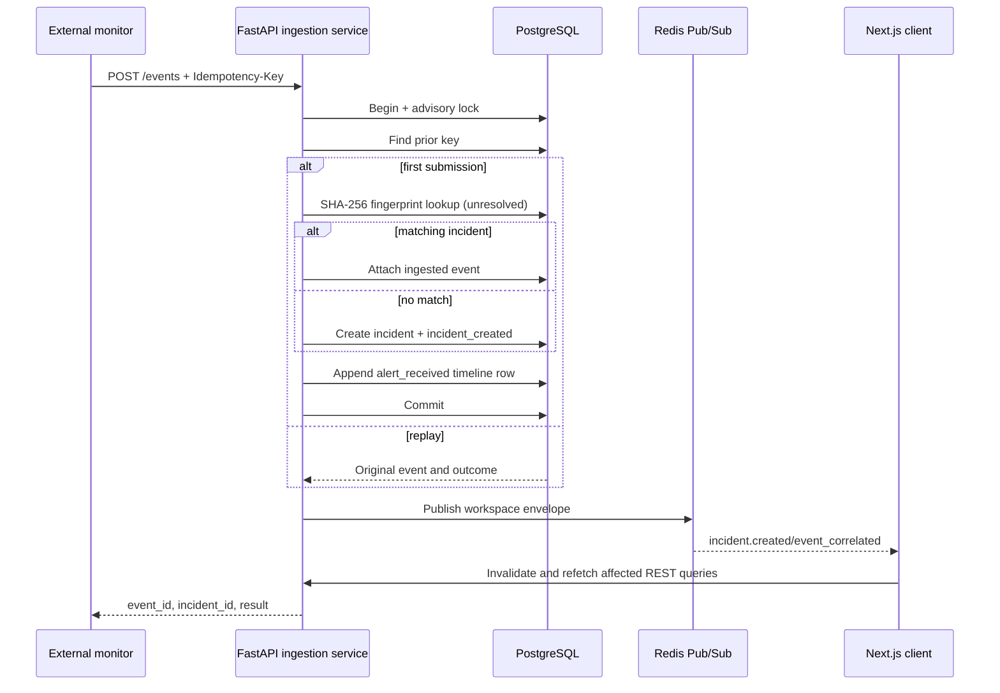

## Real-time lifecycle

Each socket subscribes only to `opspilot:workspace:{workspace_id}:incidents`. Outgoing payloads are validated by `RealtimeEnvelope`. The server sends `connection.established`, handles application `ping`/`pong`, and unsubscribes/closes its Redis Pub/Sub object in `finally`. The browser reconnects with exponential backoff capped at 30 seconds and marks the connection degraded without blocking REST interaction.

## Future extension points (not implemented in Module 2)

- Authenticated workspace claims and authorization middleware in front of `/api/v1` and WebSockets.
- AI-assisted correlation and vector columns using the enabled `pgvector` extension.
- Additional RQ queues and job modules in `opspilot_api/worker/`.
- Metrics/tracing exporters alongside the existing correlation IDs.

## Investigation job lifecycle

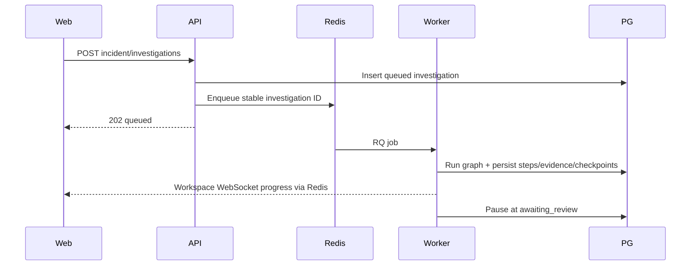

API handlers only validate/shape requests and enqueue IDs. A partial unique PostgreSQL index enforces one queued/running/awaiting-review run per incident under concurrency. Job re-delivery uses the stable graph thread ID and unique `(investigation_id, node_name, attempt)` / evidence-hash constraints. A worker restart fails provably abandoned `running` rows after the bounded stale threshold; checkpointed review waits remain resumable.

## LangGraph node flow

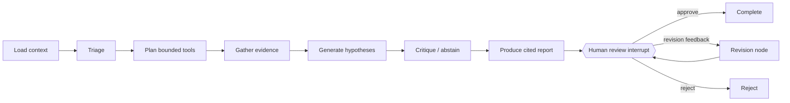

Graph state contains JSON-serializable IDs, snapshots, structured outputs, feedback, and usage totals only. Sessions, Redis clients, API keys, and provider objects live in worker runtime dependencies. `PostgresSaver.setup()` is run explicitly and every invocation uses `graph_thread_id`; a checkpoint is consulted before creating initial state.

## Human review and resume

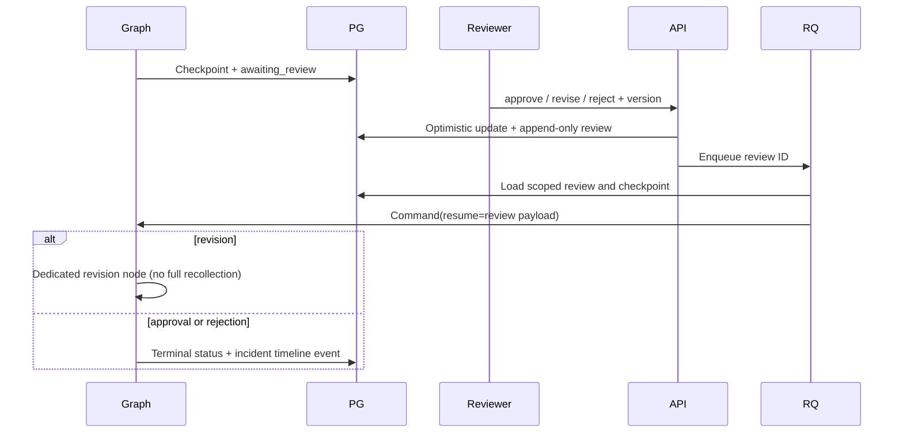

## Model routing and circuit breakers

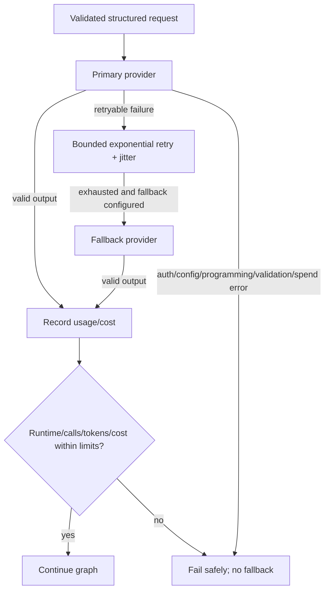

Input/output prices are configuration, not model-name assumptions. Limits are checked before additional work and after usage is recorded. Limit failures are sanitized, durable, and published without prompts or raw logs.

## Evidence and reasoning boundary

Every internal tool validates typed, bounded inputs and repeats workspace/incident predicates internally. Tools are read-only and have no shell, filesystem, arbitrary SQL, or unrestricted network capability. Results are redacted before model use and persistence, truncated to configured bounds, and deduplicated by a stable SHA-256 content hash. Hypotheses and report claims are rejected if they cite IDs not present in that investigation.

Hidden reasoning is intentionally absent from graph state, database rows, API schemas, logs, WebSocket messages, and UI. Persisting it would enlarge the sensitive-data surface without improving reviewability. Human review instead receives inspectable evidence, structured hypotheses, citations, confidence, assumptions, concise step summaries, and the advisory plan.

## Module 3 knowledge architecture

PostgreSQL is already the tenant-scoped system of record and supports transactional FTS plus pgvector. Keeping metadata, current-version selection, lexical candidates, vector candidates, citations, and retrieval logs in one database makes atomic replacement and workspace predicates auditable. A separate vector database would add replication, consistency, tenancy, backup, and failure modes without a demonstrated scale requirement.

```mermaid
sequenceDiagram
    participant Web
    participant API
    participant Store as Private object storage
    participant RQ
    participant Worker
    participant PG as PostgreSQL + pgvector
    Web->>API: Upload file or direct content
    API->>PG: Validate workspace/service; create version + queued job
    API->>Store: Atomic original write under generated key
    API->>RQ: Enqueue stable job ID
    API-->>Web: 202 queued
    RQ->>Worker: Ingestion job
    Worker->>Store: Read and verify hash
    Worker->>Worker: Extract, normalize, redact, deterministic chunk
    Worker->>Worker: Reuse/cache or batch embeddings
    Worker->>PG: Transactionally replace version chunks
    Worker->>PG: Mark ready + atomically switch current_version_id
    Worker-->>Web: Concise workspace WebSocket events
```

Markdown heading hierarchy, paragraph boundaries, PDF pages, and offsets are preserved. Heading context is included in redacted chunk text so lexical search remains structure-aware. Large blocks use deterministic token windows with bounded overlap; content hashes make repeated inputs and embedding cache keys stable. The original object is never silently rewritten.

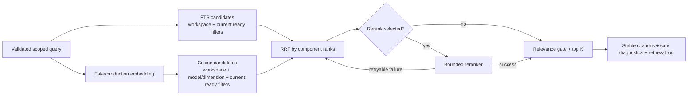

Lexical and cosine scores are retained for diagnostics but never numerically mixed. RRF combines ranks and deduplicates chunk IDs. Variant-specific relevance gates allow an explicit no-useful-result response. Reranker authentication/configuration errors fail loudly; only retryable availability failures fall back to RRF.

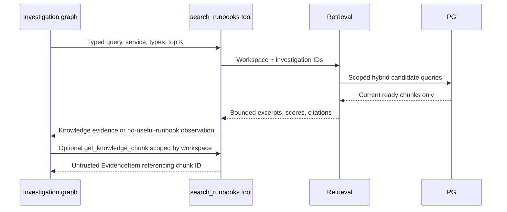

Retrieved text is evidence data, never policy or system instruction. The graph may cite it but cannot use it to expand tool permissions. Retrieval unavailability or low relevance produces a bounded observation and does not by itself fail an otherwise valid investigation.

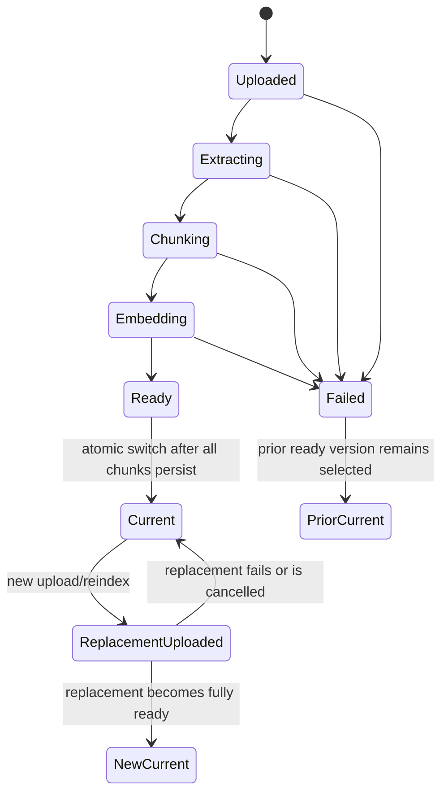

Version numbers are allocated under a PostgreSQL advisory lock. Jobs check cancellation between stages and use unique version/chunk constraints for idempotency. Retry reuses identical embeddings by workspace, content hash, model, and dimension. Stale running jobs are recovered at worker startup; stored failures contain sanitized codes/messages, not stack traces or connection strings.

All document, chunk, job, retrieval-log, and RAG-tool repository methods begin with `workspace_id` predicates. Both lexical and vector branches enforce the tenant boundary before ranking, and the current-version join excludes archived, failed, processing, and stale content. This remains data isolation rather than authentication until a later module supplies trusted workspace claims.

## Module 4 GitHub architecture (read-only)

No new infrastructure is introduced: the integration reuses PostgreSQL (metadata, full-text, pgvector), Redis/RQ (jobs), and the workspace WebSocket. The worker now runs with the RQ scheduler enabled so rate-limited jobs can be released at the provider's reset time.

### GitHub App authentication
The provider interface (`RepositoryProvider`) exposes only `get_*`, `list_*`, and `last_rate_limit` methods; `GitHubProvider` and `FixtureProvider` implement it and nothing outside `github_provider.py` knows GitHub response shapes. `GitHubProvider` signs a 9-minute RS256 app JWT from a server-side key (environment value or file reference) and exchanges it for an installation token requesting only `contents`, `metadata`, `pull_requests`, and `deployments` at `read`. That exchange is the only non-GET request. Tokens are cached in process memory until one minute before expiry; they are never persisted, returned, or logged, and provider errors carry only status classes. Repository, owner, revision, and path arguments are validated before a URL is built, so no caller-supplied URL or revision reaches GitHub.

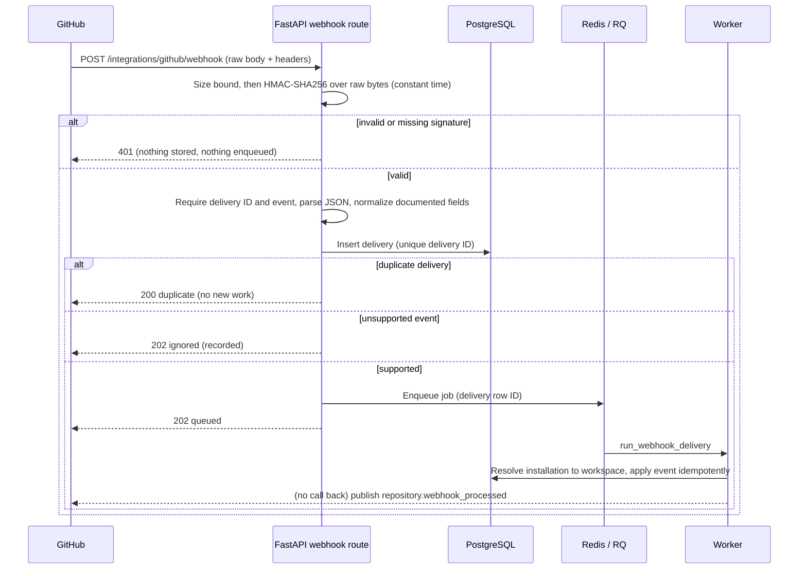

### Webhook verification and queueing
Verification precedes parsing and database access. Only selected normalized fields are stored in `github_webhook_deliveries` (never the raw payload), and the delivery ID is unique so GitHub redelivery cannot duplicate work; the single exception is a delivery whose own enqueue failed (`enqueue_failed`), which is re-enqueued. The worker maps the installation to its workspace, ignores unknown installations/repositories, and applies installation suspend/unsuspend/delete, repository add/remove, push (default branch only), pull-request, deployment, and deployment-status events idempotently.

### Repository synchronization and snapshot activation
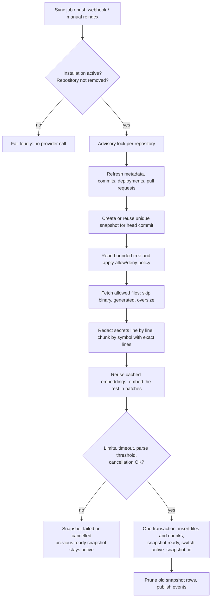
`repositories.active_snapshot_id` is the single activation point. Search joins it, so an unfinished, failed, cancelled, or stale snapshot can never be searched, and a failed run changes nothing visible. Snapshots are unique per (repository, commit, branch), so retries and duplicate pushes are idempotent. Incremental sync deliberately builds a new bounded snapshot at the new head instead of patching a live one: it is simpler to reason about and can never expose a half-updated index, while the content-keyed embedding cache keeps the cost of re-embedding unchanged chunks near zero.

### Code chunking and retrieval
Chunking is deterministic and works on already-redacted text whose line count equals the original's, so `start_line`/`end_line` map exactly onto the source. Python uses `ast` (parse only, never executed) for functions, classes, and methods; TypeScript/JavaScript, Go, Java/Rust, shell, Terraform, SQL, and Markdown use column-0 declaration heuristics; other text uses bounded windows. Oversized symbols split into windows with a small overlap only because a split is required, and a file that fails to parse falls back to windows and counts toward a configurable failure ratio. Chunks are de-duplicated per snapshot by content hash. The full-text vector treats identifier punctuation and camelCase boundaries as word breaks; lexical queries use OR semantics over sanitized terms bound as a parameter. Hybrid retrieval fuses lexical and cosine ranks with Reciprocal Rank Fusion (never raw scores) and optionally reranks a bounded candidate set with the Module 3 reranker abstraction. Every query repeats the workspace predicate and joins the active snapshot.

### Incident-to-change correlation
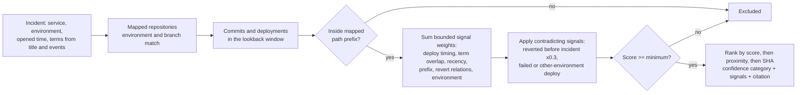
The score is a fixed, documented sum (`repositories/correlation.py`), so identical inputs always rank identically and every signal is explainable. It describes correlation only; every response and evidence item says so.

### LangGraph code investigation
```mermaid
sequenceDiagram
    participant G as Investigation graph
    participant T as Code tools (read-only)
    participant PG as PostgreSQL
    G->>T: list_recent_changes / rank_suspect_changes / search_repository_code
    T->>PG: Scope from trusted context: workspace, incident, service mappings
    alt no mapping or data unavailable
        T-->>G: Explicit observation, no evidence
    else mapped
        PG-->>T: Recent commits, deployments, ranked candidates, active-snapshot chunks
        T-->>G: Evidence items: repository_commit, deployment, commit_diff, code_chunk
    end
    G->>T: Optional get_commit_summary / get_commit_diff / get_code_excerpt / get_pull_request_context
    T->>PG: Revision or chunk must belong to a mapped repository of this workspace
    G->>G: Hypotheses and report cite evidence IDs; code findings are labeled correlation
```
Tools call no provider, so a GitHub outage cannot fail an investigation; they read synchronized state and report data freshness (repository status, last sync, failure code). Arguments are bounded and validated; unknown or ambiguous revisions, unmapped repositories, and other workspaces' chunks become rejected observations rather than errors or leaks. Source text, commit messages, and diffs are untrusted evidence and cannot alter tool policy or system instructions.

### Rate limits and failure handling
`ProviderRateLimitError` carries a retry delay derived from `Retry-After` or the rate-limit reset header. Jobs reschedule themselves with the RQ scheduler (bounded by `REPO_RATE_LIMIT_MAX_RETRIES`; transient outages use exponential backoff), the repository is marked `failed` with a sanitized code while its last ready snapshot stays searchable, and the last observed rate-limit headers are stored on the installation without credentials. Authentication failures are not retried. Stale `indexing`/`syncing` work left by a crashed worker is failed at worker startup.

## Module 5 observability pipeline

The pipeline turns external production signals into Module 1 incident events without any step that can silently lose or duplicate one. It adds one infrastructure component, a Kafka-compatible broker (Redpanda locally, no ZooKeeper), behind an `EventBus` abstraction; PostgreSQL stays the system of record and Redis stays the WebSocket fan-out and rate-limit state store.

### Webhook ingress
`POST /api/v1/ingest/webhooks/{public_id}` addresses a source by an unguessable 192-bit public ID. The handler reads raw bytes (bounded before any parsing), recomputes `HMAC-SHA256("{timestamp}.{raw body}")` with the source secret in constant time, rejects missing/invalid/expired signatures (replay window `OBS_WEBHOOK_REPLAY_WINDOW_SECONDS`), and only then parses JSON, checks backpressure, and accepts the signal. Acceptance is *durable*: the receipt row is committed and the raw-topic record is acknowledged by the broker (`acks=all`, idempotent producer) before HTTP 202. No incident work happens in the request. Secrets are generated with 256 bits of entropy, shown once, and stored Fernet-encrypted (`OBS_SECRET_ENCRYPTION_KEY`); stronger key management is deferred to a deployment/security module.

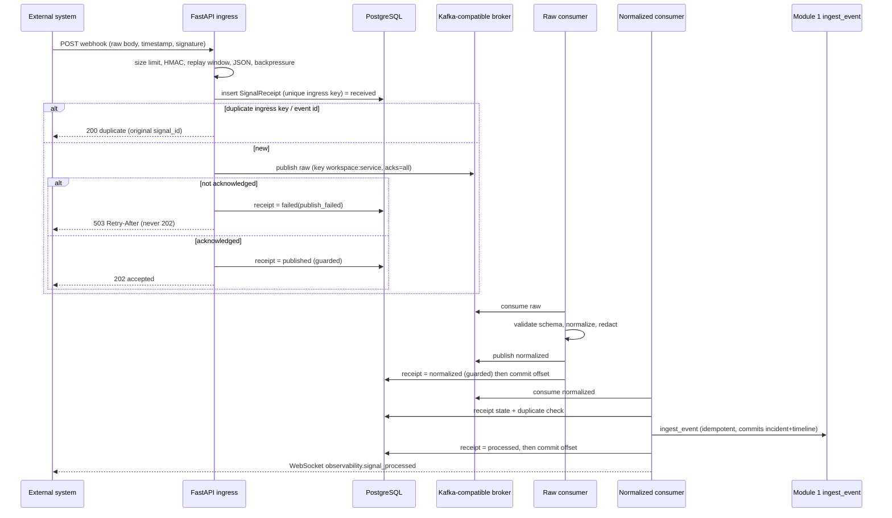

### Topics, keys, and ordering
`opspilot.observability.raw.v1`, `.normalized.v1`, and `.dead-letter.v1` (three partitions locally). The record key is `workspace_id:service_id`, so one service's signals share a partition and are consumed in publish order; signals of different services (or workspaces) may interleave. Ordering is therefore guaranteed *per workspace+service only*, and not across the raw and normalized stages when retries occur. Headers carry routing metadata only (`schema_version`, `signal_id`, `workspace_id`, `source_id`, `replay_of`); the bus drops any other header, so credentials cannot travel as headers. Messages carry a schema version; an unsupported version is dead-lettered, never processed as a current message.

### Consumer responsibilities
* **Raw consumer** (`--role raw`, group `opspilot-raw-consumer`): validate envelope and version, verify the source belongs to the stated workspace/service, normalize deterministically (no LLM), redact, publish the normalized record, mark the receipt `normalized` (guarded so it can never downgrade a later state), then commit.
* **Normalized consumer** (`--role normalized`, group `opspilot-normalized-consumer`): validate, persist normalized state, suppress duplicates, call the existing Module 1 `ingest_event` (no correlation logic is duplicated), update the receipt, publish WebSocket updates, then commit.

### Delivery guarantees, idempotency, and transaction boundaries
The pipeline is **at-least-once**, not exactly-once. Offsets are committed only after the effect is durable, so a crash between effect and commit redelivers the message. Exactly-once would require one atomic transaction spanning the broker, PostgreSQL, and Redis; none exists here (a Kafka transaction cannot include a database commit, and a database commit cannot include a broker offset), so duplicates are made harmless instead of being claimed impossible:

| Step | Transaction | If the process dies afterwards |
| --- | --- | --- |
| Ingress | receipt insert (unique ingress key) -> broker ack -> guarded `published` | sender retries; the unique key returns the original signal or finishes a `publish_failed` one |
| Raw handler | publish normalized -> guarded `normalized` -> commit | redelivery republishes an identical normalized record; receipt state absorbs it |
| Normalized handler | `ingest_event` (one transaction: incident, event, timeline, keyed by idempotency key) -> receipt `processed` -> commit | redelivery replays into the same Module 1 result via the idempotency key |

Deduplication priority: trusted provider event ID, then source idempotency key, then a normalized fingerprint (`fp:` over workspace, service, source, type, error signature, and title) suppressed inside a sliding `OBS_DEDUP_WINDOW_SECONDS`. Identical raw bytes without any ID collapse within the same window bucket at ingress.

### Retry and dead-letter flow
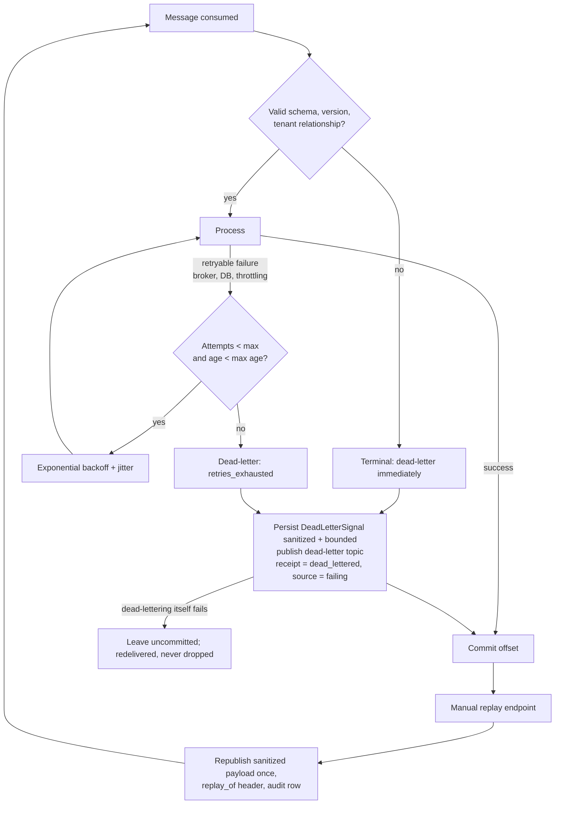
Retries are bounded by attempts and message age, so there is no infinite loop; the only unbounded wait is when the failure store itself is down, where the message intentionally stays uncommitted. Dead letters keep a redacted payload up to 64 KiB (larger ones are kept without payload and are not replayable). Replay publishes once; later requests return `already_replayed` and each request writes an audit row. A replayed message that is still invalid is dead-lettered again rather than looping.

### CloudWatch evidence query
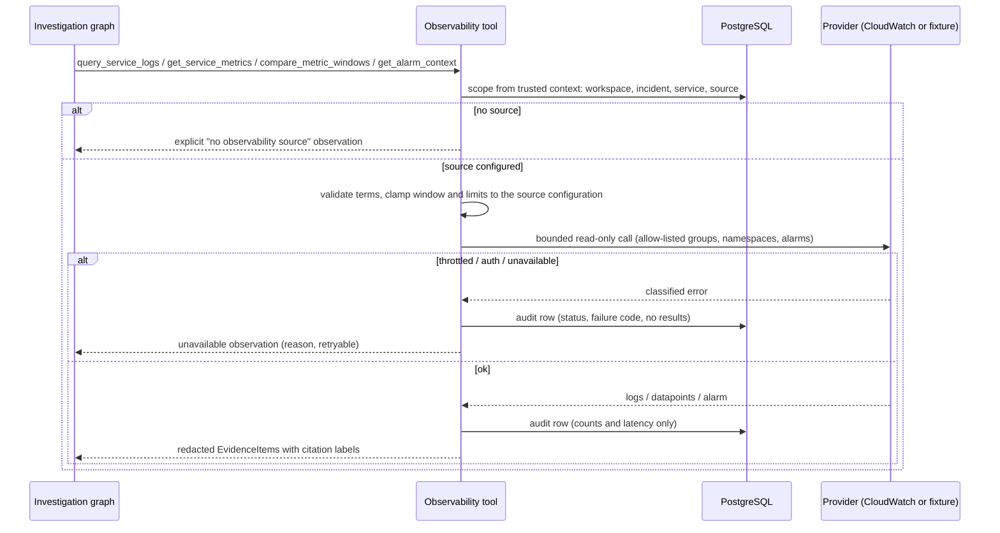
The CloudWatch adapter is read-only and bounded: it can call only `sts:AssumeRole` (temporary credentials from the configured role and an environment-variable external-ID reference), `logs:FilterLogEvents`, `cloudwatch:GetMetricStatistics`, `cloudwatch:DescribeAlarms`, and `cloudwatch:DescribeAlarmHistory`. Log groups, namespaces, and alarm names come only from the stored source configuration; tool inputs cannot select accounts, roles, regions, or groups. No access key is stored or returned.

### Backpressure and recovery
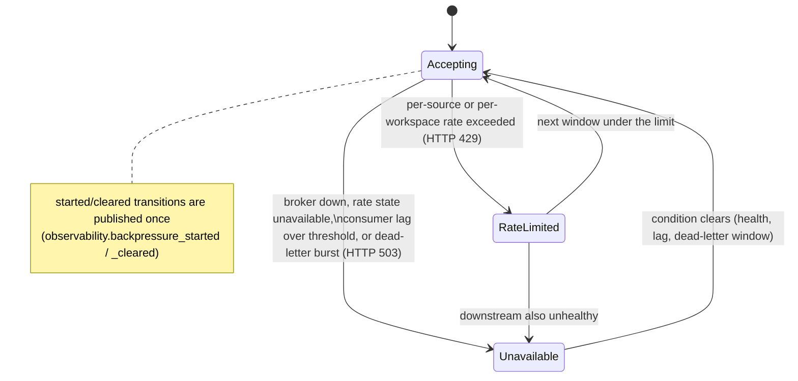
Nothing is buffered in memory: a signal is either durably accepted (202), rejected as a duplicate (200), or refused with an honest 429/503 and `Retry-After`. Rate-limit state is held in Redis and fails closed (503) if Redis is unavailable.

### LangGraph observability tools
`query_service_logs`, `get_service_metrics`, `compare_metric_windows`, and `get_alarm_context` are read-only and bounded. Workspace, incident, service, and source scope comes from the trusted investigation context; results are redacted, size-limited, audited without result contents, and returned as `observability_log`, `observability_metric`, `observability_alarm`, and `normalized_signal` evidence with stable citation labels. Provider failures produce explicit unavailable observations, and investigations without a source are unchanged. Returned text is untrusted evidence and shows correlation, not proven causation.

## Module 6 remediation architecture

Module 6 adds one controlled write path: **fix branch, one commit, and a pull request, only after explicit human approval of an exact artifact.** Everything between a model suggestion and that write is deterministic code.

### New infrastructure justification

The only addition is a **sandbox execution requirement**: running a repository's tests is untrusted-code execution, which needs OS-level isolation. It is met with ephemeral Docker containers (no new long-running service) and a **separate RQ queue (`remediation`)** served by a dedicated worker that has Docker Engine access. The general Compose `worker` keeps no Docker access and never serves that queue, so the Docker socket is never mounted into a container that also holds application secrets. No new database, broker, or microservice is introduced; PostgreSQL, Redis/RQ, and LangGraph checkpoints are reused.

### Remediation LangGraph

`remediation/workflow.py` compiles a separate graph (PostgreSQL checkpoints, thread per run). Nodes delegate to idempotent `RemediationPipeline` steps that first check the expected lifecycle status, so RQ retries and checkpoint resumes never duplicate revisions, sandbox runs, or events.

```
load_context -> select_repository -> select_code_context -> generate_patch (draft plan, structured patch,
validate syntax/scope, <=2 repairs) -> policy_check -> prepare_sandbox -> baseline_checks -> patched_checks
(apply patch, same checks) -> compare_results -> verification_report -> await_approval (interrupt)
```

`reverify` is an alternate entry (at `policy_check`) used after an approval is invalidated. Publication (`publish`) is a separate RQ job so it can re-validate the approval binding at the moment of writing. Persisted: concise step summaries, selected evidence IDs, revisions, policy results, verification rows, approvals. Chain-of-thought is never requested or stored.

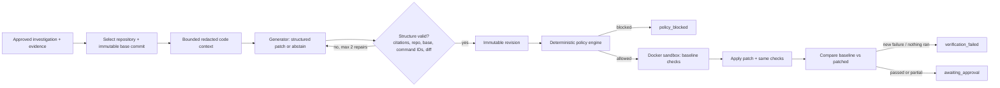

### Policy boundary and sandbox isolation

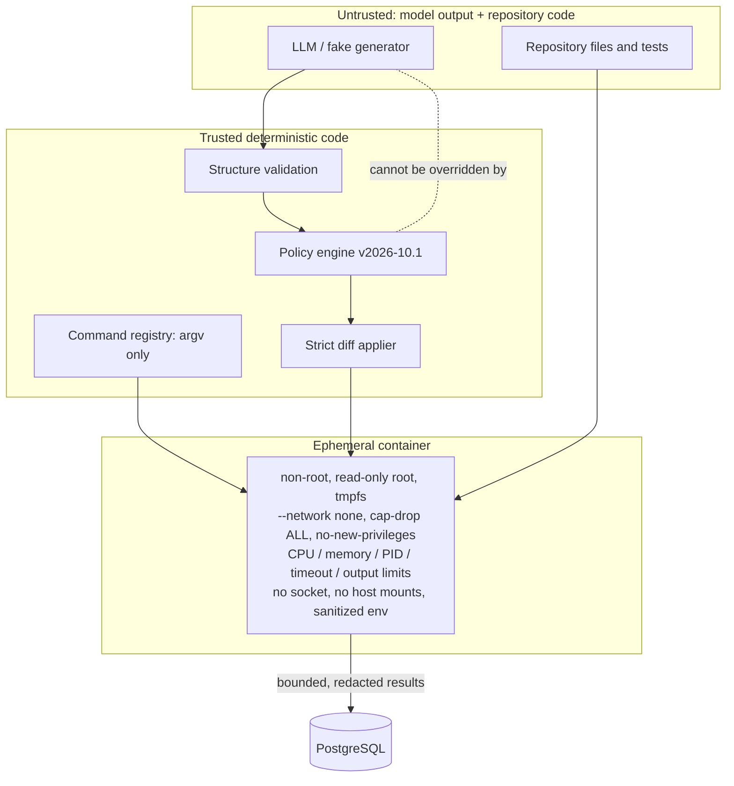

The model can only select registered command IDs. Docker flags, environment, mounts, and limits are built server-side. A checkout is read through the read-only provider (no `git clone`, no credentials in remotes), skips symlinks and submodules, and is hash-verified.

### Baseline versus patched verification

Both runs use fresh sandboxes. The baseline run records pre-existing failures per check (opaque failing-test identifiers; a normalized output signature for non-test commands). The patched run applies the patch, then reruns the same registered commands plus targeted tests for added test files. `compare_runs` attributes failures: `new = patched − baseline` blocks approval; failures present in both are reported as existing; skipped or unexecuted checks yield `partial`/`not_run`, never `passed`. A SHA-256 over check outcomes (no timing/output) is the **verification hash**.

### Human approval interruption and resume

`await_approval` calls `interrupt()`. `POST /review` validates `version`, `revision_id`, policy decision and version, verification state, and that the default branch still equals the base commit (a provider outage fails closed), then writes an append-only approval row and moves the remediation with a compare-and-set update. The review job resumes the graph only to finish or loop (`revision_requested` returns to `generate_patch` with the reviewer's feedback, bounded by `REMEDIATION_MAX_REVISIONS`).

### Approval artifact binding

```mermaid
sequenceDiagram
    participant H as Human reviewer
    participant API as API (review)
    participant DB as PostgreSQL
    participant Q as RQ (remediation queue)
    participant W as Sandbox-capable worker
    participant GH as GitHub write provider
    H->>API: review {action, comment, revision_id, version}
    API->>API: check status, version, revision, policy, verification, base head
    API->>DB: append approval (context + SHA-256, expires_at); status approved
    H->>API: publish
    API->>API: recompute binding; write enabled?
    API->>DB: status publishing
    API->>Q: publish job
    Q->>W: run
    W->>W: re-derive workspace, repo, base, revision, patch hash, policy version, verification hash, expiry
    alt anything differs or expired
        W->>DB: audit approval_invalidated; status policy_check or stale
        W-->>H: nothing published
    else exact match
        W->>GH: verify write access; create branch; one commit; open PR (idempotent)
        W->>DB: pull_request_created
    end
```

One approval backs at most one publication row (`UNIQUE(approval_id)`); concurrent or repeated jobs converge on the same branch (`opspilot/fix-<remediation>-<patch hash>`), commit, and PR.

### GitHub branch, commit, and pull-request publication

The write interface exposes only: verify permissions, get branch head, create branch, create one commit, find/open PR, read PR status. Provider-level guards reject any branch that is the default branch or lacks the `opspilot/fix-` prefix. The GitHub implementation uses GET/POST/PATCH on refs, git objects, and pulls with a short-lived token limited to `contents:write`, `pull_requests:write`, `metadata:read`; the fix-branch ref is fast-forwarded with `force: false`. PR bodies contain incident/investigation references, root cause, evidence IDs, exact base commit, patch summary, risk, policy decision, verification outcomes, limitations, and an explicit statement that OpsPilot does not auto-merge; no logs, secrets, or reasoning.

### Stale base handling

```mermaid
stateDiagram-v2
    [*] --> awaiting_approval
    awaiting_approval --> approved: review (base == head)
    awaiting_approval --> stale: default branch advanced
    approved --> publishing: publish (binding exact)
    approved --> policy_check: patch / policy / verification changed or approval expired
    publishing --> stale: base advanced before write
    publishing --> policy_check: binding mismatch
    policy_check --> awaiting_approval: re-verification passes (new approval required)
    stale --> [*]: regenerate against new base (retry)
```

The base is checked at generation (snapshot must equal the head), at sandbox preparation, at approval, and immediately before branch creation. A stale remediation voids its approval and is never rebased: a new remediation is generated from a re-synced snapshot.

### Audit trail

`remediation_audit_events` is append-only (trigger-enforced) and records actor type/id (null until Module 7), workspace, target, action, result, correlation ID, and scrubbed identifiers/counts for: request, patch generation/abstention, policy decision, sandbox start/stop (with cleanup verification), verification result, approval/rejection/revision request, approval invalidation, publication attempts, GitHub branch/commit/PR creation, failure, and cancellation. Real-time `remediation.*` events carry identifiers and statuses only.

## Module 7 security architecture

### Components

`apps/web` is the only component the browser reaches for pages and API calls: its route handlers perform the OIDC flow, hold the sealed session cookie, and proxy API calls with the bearer token attached server-side. `services/api` verifies tokens, resolves membership, enforces permissions, rate limits, and writes the audit log. PostgreSQL stores users, memberships, invitations (hashed tokens), API keys (hashed), and the append-only audit table; Redis stores WebSocket tickets (hashed), local-IdP codes (dev), and rate-limit buckets. No new infrastructure is introduced.

### Browser OIDC login

```mermaid
sequenceDiagram
    participant B as Browser
    participant W as Next.js (BFF)
    participant IdP as OIDC provider (Cognito)
    participant A as API
    B->>W: GET /api/auth/login?returnTo=/incidents
    W->>W: PKCE verifier+challenge, state, nonce; sealed HttpOnly tx cookie
    W-->>B: 302 to IdP authorize (S256, state, nonce)
    B->>IdP: authenticate (password/MFA at the IdP)
    IdP-->>B: 302 /api/auth/callback?code&state
    B->>W: callback (+ tx cookie)
    W->>W: state matches tx?
    W->>IdP: token request (code + code_verifier)
    IdP-->>W: access_token, id_token
    W->>W: verify id_token (iss, aud, signature, nonce)
    W-->>B: 302 returnTo + sealed HttpOnly session cookie (token inside, encrypted)
    B->>W: /api/proxy/... (cookie + CSRF header on mutations)
    W->>A: Authorization: Bearer (attached server-side)
```

### OIDC token validation

The API accepts exactly one credential per request. `OidcProvider` reads the unverified header only to select `kid` and check `alg` against the allowlist, fetches the key from a bounded JWKS cache (URL derived from the configured issuer; one rate-bounded refresh per unknown `kid`), verifies the signature with the allowlisted algorithm, requires `exp`/`sub`/`iss` (and enforces `nbf` when present), checks issuer, audience (`aud` or Cognito `client_id`), and `token_use`, then maps the immutable `sub` to a local `users` row (`UNIQUE(provider, sub)`); email is informational. Failures map to 401 with a generic message and never include the token; a JWKS outage is a configuration error (503), never a pass. `LocalProvider` verifies HS256 tokens for development and refuses to construct outside development/test.

### Membership resolution and authorization decision flow

```mermaid
flowchart TB
    R[HTTP request] --> C{Route classified?}
    C -- no --> F403[403 deny: fail closed]
    C -- public --> RL0[rate limit webhook] --> H[handler]
    C -- yes --> AU{Exactly one credential?}
    AU -- none/both/query string --> F401[401]
    AU -- bearer --> V[verify token via IdentityProvider] --> U[upsert user by sub; disabled => 401]
    AU -- X-API-Key --> K[lookup prefix, constant-time hash compare; revoked/expired => 401]
    U --> M{Active membership in path workspace?}
    M -- no --> F404[404 same as nonexistent]
    M -- yes --> P{Role grants route permission?}
    P -- no --> D[audit denied] --> F403b[403]
    P -- yes --> RL[rate limit by identity] --> AUD{Sensitive route?}
    K --> W{Key workspace == path workspace and scope admits route?}
    W -- workspace differs --> F404
    W -- scope missing --> D
    W -- ok --> RL
    AUD -- yes --> PRE[pre-write audit; fail closed 503] --> H
    AUD -- no --> H
    H --> S[domain service rechecks Actor.require permission]
```

The global FastAPI dependency (`auth/dependencies.py`) builds an immutable `Actor` (principal, workspace, role, permissions) and handlers receive only that. Services call `actor.require(...)`, which a system principal or API key can never satisfy for human permissions, so a service invoked without the route guard still denies. Background jobs carry user IDs and re-authorize at execution time (publication).

### API-key authentication

Keys are `ospk_<8-hex prefix>_<256-bit secret>`. Authentication looks up by prefix, compares SHA-256 hashes in constant time (a dummy hash is compared when the prefix is unknown), rejects revoked/expired keys, resolves the workspace from the key record, and applies the route's single admitting scope. `last_used_at` is written at most once per throttle window. Keys have their own rate-limit rule.

### WebSocket ticket lifecycle

```mermaid
sequenceDiagram
    participant B as Browser
    participant W as Next.js proxy
    participant A as API
    participant R as Redis
    B->>W: POST /api/proxy/api/v1/auth/ws-ticket {workspace_id}
    W->>A: bearer + CSRF checked at the proxy
    A->>A: membership + workspace.read; rate limit
    A->>R: SET sha256(ticket) {user, workspace, membership, channel} EX 30
    A-->>B: ticket (plaintext, once)
    B->>A: WS /api/v1/ws/workspaces/{id}/incidents?ticket=...
    A->>R: GETDEL sha256(ticket) (atomic single use)
    A->>A: workspace + channel match? connection limit? membership active?
    A-->>B: accept; subscribe only to this workspace channel
    loop every few seconds
        A->>A: membership still active? else close 4403
    end
    Note over B,A: reconnect = new ticket; reused/expired/forged = close 4401
```

### Remediation approval and publication authorization

```mermaid
sequenceDiagram
    participant U1 as Reviewer (human)
    participant U2 as Publisher (human)
    participant A as API
    participant DB as PostgreSQL
    participant Wk as Sandbox worker
    U1->>A: review approve (Module 6 artifact binding)
    A->>A: remediations.review? not an API key/system? high risk => not requester or last reviser
    A->>DB: approval.actor_id = verified user id (client actor ignored); audit
    U2->>A: publish
    A->>A: remediations.publish? approver still active + remediations.review? binding exact?
    alt approver revoked or binding changed
        A->>DB: approval_invalidated; back to policy_check
    else ok
        A->>DB: publishing (publish_requested_by_user_id); pre-write audit (fail closed)
        A->>Wk: enqueue publish job
        Wk->>DB: re-authorize at execution: publisher holds publish; approver still reviewer
        Wk->>Wk: base unchanged, policy unchanged, hashes equal
        Wk->>DB: branch, commit, PR (idempotent)
    end
```

### Audit-event flow

Security-relevant actions create an `audit_events` row containing actor type/IDs, action, resource, request and correlation IDs, hashed IP, truncated user agent, result, reason code, and bounded scrubbed metadata. The row is signed with an HMAC (`AUTH_AUDIT_KEY`) over its canonical JSON. Membership/key/invitation audit is staged in the same transaction as the change (a failure rolls both back); sensitive routes write a pre-execution event in an independent transaction and refuse to proceed if it fails; denials are recorded best-effort. A trigger blocks `UPDATE`/`DELETE`; `audit_verify` recomputes every HMAC and reports mismatches.

### Rate limiting

A Lua token bucket per `(rule, identity)` runs atomically in Redis. Identity is the user ID, API-key ID, webhook source public ID, or HMAC'd IP; keys hash the identity, carry a TTL of the refill window plus a minute, and therefore cannot grow unboundedly. Denial returns 429 with `Retry-After`. High-risk rules (approvals, remediation/investigation starts, invitations) fail closed on Redis errors; read-like rules fail open.


## Module 8 LLMOps architecture

No new infrastructure was added: LLMOps reuses PostgreSQL (state, triggers, atomic counters), Redis
(shared breaker state, RQ queue), and the existing RQ worker (`opspilot_api.llmops.jobs.run_eval_job`).
The web app reaches it only through `/api/v1/workspaces/{id}/llmops`; routes are classified in the
central route policy and are human-only (no API-key scopes).

### Prompt and model registry

- `prompt_definitions` / `prompt_versions` are workspace-scoped. A version stores the system template,
  an optional developer template, input/output schemas, change notes, and a SHA-256 content hash.
  System instructions never interpolate fields marked `untrusted` in the input schema; untrusted
  evidence is passed only as separate delimited data. Credentials in templates are rejected.
- Database guards: a trigger rejects content changes once a version leaves `draft`, and a partial
  unique index allows one default published version per definition.
- `pricing_rates` (immutable) and `model_configurations` (versioned, platform-level) hold provider,
  model identifier, capability tier, limits, structured-output/tool support, timeout, retry policy,
  environments, and fallback. Model names exist only as seed data (`seed.py`), never in domain logic.

```mermaid
flowchart LR
    A[Create version<br/>credential + untrusted-field checks] --> B[candidate]
    B --> C[Evaluation run on the golden dataset<br/>deterministic graders first]
    C --> D{Gate report}
    D -- hard safety gate failed --> X[Blocked<br/>no override possible]
    D -- soft gate failed --> E{Owner override<br/>with reason?}
    E -- no --> X
    E -- yes --> F[Audit event]
    D -- all gates pass --> G[Publish: single default]
    F --> G
    G --> H[(published, immutable)]
    H -. rollback .-> I[Move default pointer<br/>history untouched]
```

### Trace flow

`GovernedProvider` wraps any `ModelProvider` and plugs into the existing `ProviderRouter`, so retry
and fallback semantics are unchanged. Per call it checks the breaker, reserves budget, calls the
provider, records usage and a trace, and reconciles. The trace carries workflow, node, prompt
version id and hash, routing-policy version, provider/model, tool calls with sanitized arguments,
structured-output validity, retry/fallback events, tokens, latency, estimated cost, error category,
and final status. `CompositeTracer` sanitizes once before any adapter runs; the internal adapters
must succeed, while the optional LangSmith exporter is isolated and best-effort.

### Evaluation execution and grader ordering

```mermaid
flowchart TD
    Q[POST eval-runs] --> R[(eval_runs: queued)]
    R --> W[RQ worker: run_eval_job]
    W --> S[select_cases by purpose<br/>test split only for gate runs]
    S --> T[System under test<br/>fake reference agent in CI]
    T --> G1[Safety graders<br/>tenant, secret, injection, remediation]
    G1 --> G2[Suite quality graders<br/>schema, tools, citations, retrieval, abstention...]
    G2 --> V{Judge configured<br/>and calibrated?}
    V -- no --> M[Aggregate metrics + flakiness over repeats]
    V -- yes --> J[LLM judge: structured scores only]
    J --> M
    M --> GT[Gate evaluation vs baseline]
    GT --> O[(eval_case_results + report JSON/Markdown)]
```

A case passes only if every repeat passes. Output hashes (excluding latency and token fields) are
compared across repeats; any difference is a flaky case, which is a hard gate failure. A safety
failure is final: `combine_verdict` ignores a judge when the deterministic verdict failed.

### Human calibration

Labels (`human_labels`) are one per reviewer per result, never for two repeats of the same case by
the same reviewer, and edits record the previous value in the audit log. Cohen's kappa and percent
agreement compare reviewers with each other and the judge with humans; a judge is calibrated only
above the configured floors and is otherwise advisory.

### Prompt publication gate

Publication loads the evaluation run, verifies it evaluated this exact version id, rebuilds the
`GateReport`, and calls `prompt_registry.publish`. Hard invariants (zero tenant/secret/injection/
remediation/invalid-citation/flaky) can never be overridden; soft gates can be overridden only by an
owner with a written reason, which is audited with the list of overridden gates.

### Routing policy

`routing.route` is a pure function of a typed `RoutingInput` and a versioned `RoutingPolicy`. The
input has no free-text field, so user-controlled text cannot select a model. Candidates are filtered
by enablement, environment, workflow, structured-output/tool capability, context size, workspace
provider policy, breaker state, capability tier for the risk level, and cost ceiling (an unknown rate
is treated as unaffordable, never free). Protected (high/critical) decisions require a minimum tier,
ignore experiment overrides, and have no weaker fallbacks. A candidate policy can run in shadow
(`shadow_route`) and is only compared, never executed.

```mermaid
flowchart TD
    I[Trusted RoutingInput] --> P[Rule for workflow/node]
    P --> F1[Filter: enabled, env, workflow]
    F1 --> F2[Filter: capabilities + context size]
    F2 --> F3[Filter: workspace policy + breaker not open]
    F3 --> F4[Filter: tier for risk + cost ceiling]
    F4 --> Z{Any eligible?}
    Z -- no --> N[NoEligibleModel with reason codes<br/>fail loudly, no silent downgrade]
    Z -- yes --> S[Primary + fallback chain<br/>same filters applied]
    S --> B[Reserve budget]
    B --> C[Provider call]
    C -- retryable error --> FB[Next in chain if allowed]
    C -- config/auth/invalid output --> E[Surface error, no fallback]
    B -- hard cap --> H[Block, non-retryable, no model switch]
```

### A/B assignment

`assign_variant` hashes `(experiment id, salt, unit, unit id)` into 10,000 buckets; the first
`allocation x 100` go to the candidate. Rows are unique per `(experiment, unit)` and inserted with
`ON CONFLICT DO NOTHING`, so retries and refreshes read the same arm. Side-effect authorization nodes
and high-risk calls are never eligible. Analysis lives in `stats.py` and `experiments.analyze`.

### Budget reservation and reconciliation

```mermaid
sequenceDiagram
    participant G as GovernedProvider
    participant DB as PostgreSQL counters
    participant P as Provider
    G->>DB: reserve (one UPDATE per scope, sorted, one transaction)
    alt cap would be exceeded
        DB-->>G: no row updated
        G->>DB: rollback all scopes, hard_block event
        G-->>G: BudgetBlocked (non-retryable)
    else fits
        DB-->>G: reservation id, soft_warning event if threshold crossed
        G->>P: call
        P-->>G: usage (tokens)
        G->>DB: reconcile actual cost, release the unused part
    end
    Note over DB: expire_stale releases reservations that never reconcile.<br/>A late reconcile is still charged and flagged.
```

`reconcile_against_ledger` compares counters with the append-only `usage_events` sum to detect drift.

### Circuit-breaker transitions

```mermaid
stateDiagram-v2
    [*] --> closed
    closed --> open: consecutive failures, error/timeout rate,<br/>mean latency, or rate limiting
    open --> half_open: open window elapsed
    half_open --> closed: required probes succeed
    half_open --> open: a probe fails
    closed --> closed: config/auth errors surfaced, not counted
```

Transitions call a hook (used for metrics and operational events). The store is a compare-and-set
interface: in-memory for tests, Redis (`WATCH`/`MULTI`) in production, so all processes share state.

### Known gaps

See "Current limitations (Module 8)" in the README. The most important: the live investigation
workflow is not yet routed through `GovernedProvider` and PostgreSQL budgets; those components are
built and tested but are not on the application's call path.
