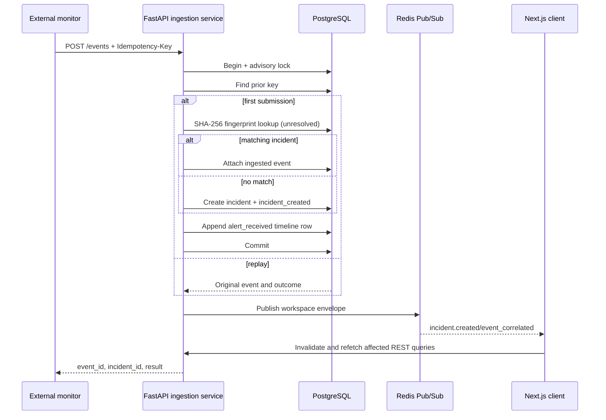
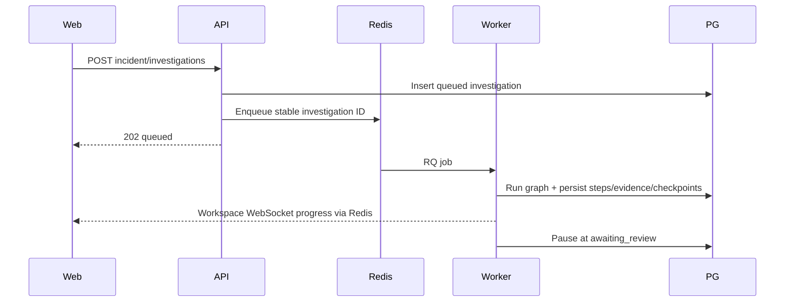
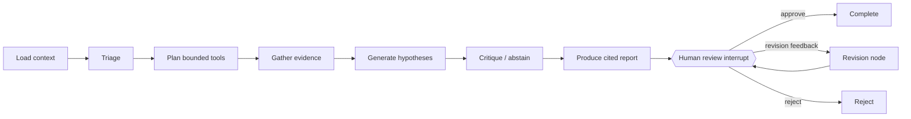
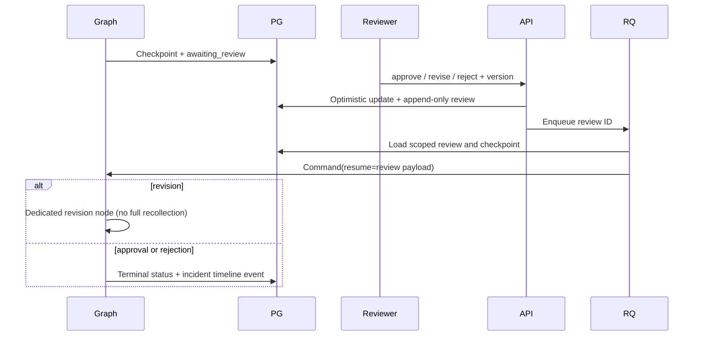
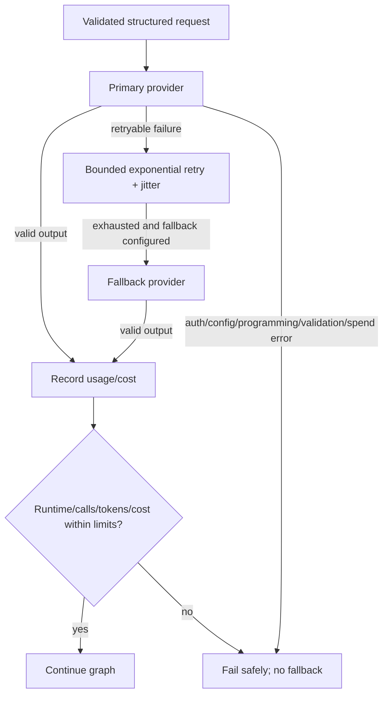
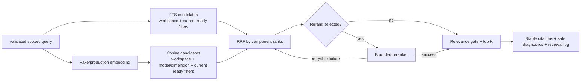
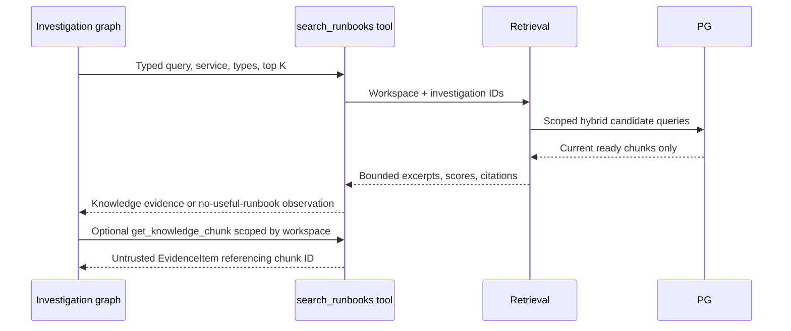
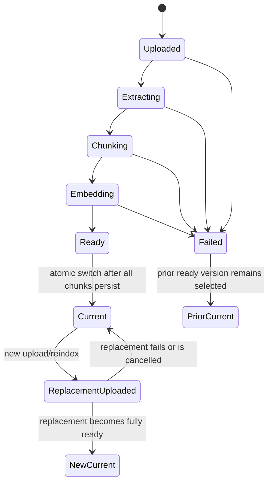

# OpsPilot AI - Architecture (Module 2)

## Container view


## Responsibilities

| Container | Responsibility in Module 0 |
| --- | --- |
| **web** | Serves the incident dashboard, list, detail, creation, and service settings. TanStack Query owns server state; a reconnecting WebSocket invalidates affected caches. |
| **api** | Versioned REST/WebSocket API, health endpoints, tenant-scoped incident application services, structured logging, and PostgreSQL/Redis lifecycles. |
| **worker** | Runs durable investigation graphs and smoke-test jobs. It owns model/tool execution and recovers stale running investigations at startup. |
| **postgres** | System of record for incidents, investigation steps/evidence/reviews, reports, and LangGraph checkpoints. Alembic owns application schema; checkpoint setup is explicit. |
| **pgvector** | PostgreSQL extension enabled by migration `0001`, reserved for later embedding storage. No vector columns exist yet. |
| **redis** | RQ backend and workspace-isolated incident Pub/Sub channels. Persisted with AOF to a named volume. |

## Readiness request flow

1. The browser loads `/` from **web**; the page validates `NEXT_PUBLIC_API_BASE_URL`, then renders the dashboard.
2. The dashboard calls `GET {API}/health/ready` on load, every 10 s, and on "Refresh".
3. **api** probes PostgreSQL (`SELECT 1`) and Redis (`PING`) concurrently, each under `DEPENDENCY_TIMEOUT_SECONDS`.
4. Both up: HTTP 200 `{"status":"ready", ...}`. Any down: HTTP 503 `{"status":"degraded", ...}` with per-dependency `up`/`down`. Errors are logged by class only; no credentials or connection strings are returned or logged.
5. The dashboard shows "All systems ready" (200), "Degraded" (503 body), or "Backend unreachable" (network failure, other status, or a malformed body - never reported as healthy).

`GET /health/live` does not touch any dependency, so a container health check cannot be failed by an outage it cannot fix.

## Key decisions

- **Modular monolith.** One backend codebase (`services/api`), run as two processes (API, worker) from one image. Module boundaries are Python packages, not network hops.
- **App factory.** `create_app(settings)` makes the app testable without environment mutation; readiness is injected via a FastAPI dependency so tests can fake dependency states.
- **Fail-fast configuration.** Pydantic Settings has no credential defaults; startup fails on missing or invalid values. Secrets are `SecretStr`. Wildcard CORS is rejected outside `development`.
- **Lazy connections.** The API starts even if PostgreSQL/Redis are down and reports it through readiness (503) rather than crashing in a restart loop.
- **Sync Alembic, async app.** Migrations use a synchronous psycopg connection (simple, robust); the app uses SQLAlchemy async.
- **Compose-level health ordering.** `api` waits for healthy `postgres` and `redis`; `worker` waits for `redis`; `web` waits for `api`. The worker's health check verifies it is registered in Redis.
- **Loopback-only host ports.** Published ports bind to `127.0.0.1` and are configurable (`*_HOST_PORT`) to avoid collisions.
- **Browser-side fetch.** The dashboard polls the API from the browser (needs CORS) so it reflects what a user's browser can reach, instead of proxying through the web server.

## Why a modular application, not microservices

There is one team-sized domain and no independent scaling, deployment cadence, or data-ownership boundary yet. Microservices would add network failure modes, distributed tracing/versioning, and operational cost with no benefit. The API and worker already deploy separately from one codebase; if a module later needs independent scaling or isolation, it can be split along its existing package boundary.

## Module 3 infrastructure requirement

Module 3 accepts private operational files, so local development needs one durable, non-public
filesystem location shared by the API and worker. Docker Compose therefore adds a named
`knowledge_data` volume mounted at `/app/data/knowledge`; no new service, database, queue, or
network endpoint is introduced. PostgreSQL remains the metadata, full-text, vector, and citation
system of record. The filesystem abstraction keeps generated storage keys separate from user
filenames and leaves an S3-compatible implementation as a deployment adapter rather than a local
dependency.

## Module 1 data and isolation

`Workspace` is the future tenant boundary. Every service, incident, timeline, and ingested-event query includes `workspace_id`; nested resources return 404 when the resource exists in a different workspace. A composite service constraint allows the same slug in different workspaces. An incident can only reference a service found by `(workspace_id, service_id)`.

This is data scoping, not authorization. Workspace IDs are explicitly selected in URLs and the WebSocket path; Module 1 has no authenticated workspace claim. Authentication and authorization middleware can later replace the explicit context without changing domain-service signatures.

## Transaction and concurrency boundaries

- Manual creation writes the incident and `incident_created` timeline row in one transaction.
- Status, severity, and note operations use `UPDATE ... WHERE workspace_id = ? AND id = ? AND version = ?`; success increments `version`, while a stale write returns HTTP 409. The timeline append shares that transaction.
- Ingestion takes a transaction-scoped PostgreSQL advisory lock derived from `(workspace_id, idempotency_key)`. The unique constraint is the final concurrent-replay backstop. Correlation, incident creation, ingested-event persistence, and timeline append commit together.
- Redis publication happens after the database commit. Pub/Sub is intentionally ephemeral; Redis failure is logged by error class and does not turn a durable REST mutation into a false failure. Clients recover by refetching REST state.

## Deterministic event correlation

Module 1 uses SHA-256 over normalized workspace ID, service ID, event type, and error signature. Case and whitespace are normalized; the full alert summary is not included because timestamps, UUIDs, and changing metrics make it unstable. An unresolved incident with the same fingerprint is reused; otherwise a new incident is created. This is explainable, testable, and account-free. Semantic/AI-assisted correlation is deferred until deterministic behavior provides a safe baseline.



## Real-time lifecycle

Each socket subscribes only to `opspilot:workspace:{workspace_id}:incidents`. Outgoing payloads are validated by `RealtimeEnvelope`. The server sends `connection.established`, handles application `ping`/`pong`, and unsubscribes/closes its Redis Pub/Sub object in `finally`. The browser reconnects with exponential backoff capped at 30 seconds and marks the connection degraded without blocking REST interaction.

## Future extension points (not implemented in Module 2)

- Authenticated workspace claims and authorization middleware in front of `/api/v1` and WebSockets.
- AI-assisted correlation and vector columns using the enabled `pgvector` extension.
- Additional RQ queues and job modules in `opspilot_api/worker/`.
- Metrics/tracing exporters alongside the existing correlation IDs.

## Investigation job lifecycle



API handlers only validate/shape requests and enqueue IDs. A partial unique PostgreSQL index enforces one queued/running/awaiting-review run per incident under concurrency. Job re-delivery uses the stable graph thread ID and unique `(investigation_id, node_name, attempt)` / evidence-hash constraints. A worker restart fails provably abandoned `running` rows after the bounded stale threshold; checkpointed review waits remain resumable.

## LangGraph node flow



Graph state contains JSON-serializable IDs, snapshots, structured outputs, feedback, and usage totals only. Sessions, Redis clients, API keys, and provider objects live in worker runtime dependencies. `PostgresSaver.setup()` is run explicitly and every invocation uses `graph_thread_id`; a checkpoint is consulted before creating initial state.

## Human review and resume



## Model routing and circuit breakers



Input/output prices are configuration, not model-name assumptions. Limits are checked before additional work and after usage is recorded. Limit failures are sanitized, durable, and published without prompts or raw logs.

## Evidence and reasoning boundary

Every internal tool validates typed, bounded inputs and repeats workspace/incident predicates internally. Tools are read-only and have no shell, filesystem, arbitrary SQL, or unrestricted network capability. Results are redacted before model use and persistence, truncated to configured bounds, and deduplicated by a stable SHA-256 content hash. Hypotheses and report claims are rejected if they cite IDs not present in that investigation.

Hidden reasoning is intentionally absent from graph state, database rows, API schemas, logs, WebSocket messages, and UI. Persisting it would enlarge the sensitive-data surface without improving reviewability. Human review instead receives inspectable evidence, structured hypotheses, citations, confidence, assumptions, concise step summaries, and the advisory plan.

## Module 3 knowledge architecture

PostgreSQL is already the tenant-scoped system of record and supports transactional FTS plus pgvector. Keeping metadata, current-version selection, lexical candidates, vector candidates, citations, and retrieval logs in one database makes atomic replacement and workspace predicates auditable. A separate vector database would add replication, consistency, tenancy, backup, and failure modes without a demonstrated scale requirement.

```mermaid
sequenceDiagram
    participant Web
    participant API
    participant Store as Private object storage
    participant RQ
    participant Worker
    participant PG as PostgreSQL + pgvector
    Web->>API: Upload file or direct content
    API->>PG: Validate workspace/service; create version + queued job
    API->>Store: Atomic original write under generated key
    API->>RQ: Enqueue stable job ID
    API-->>Web: 202 queued
    RQ->>Worker: Ingestion job
    Worker->>Store: Read and verify hash
    Worker->>Worker: Extract, normalize, redact, deterministic chunk
    Worker->>Worker: Reuse/cache or batch embeddings
    Worker->>PG: Transactionally replace version chunks
    Worker->>PG: Mark ready + atomically switch current_version_id
    Worker-->>Web: Concise workspace WebSocket events
```

Markdown heading hierarchy, paragraph boundaries, PDF pages, and offsets are preserved. Heading context is included in redacted chunk text so lexical search remains structure-aware. Large blocks use deterministic token windows with bounded overlap; content hashes make repeated inputs and embedding cache keys stable. The original object is never silently rewritten.



Lexical and cosine scores are retained for diagnostics but never numerically mixed. RRF combines ranks and deduplicates chunk IDs. Variant-specific relevance gates allow an explicit no-useful-result response. Reranker authentication/configuration errors fail loudly; only retryable availability failures fall back to RRF.



Retrieved text is evidence data, never policy or system instruction. The graph may cite it but cannot use it to expand tool permissions. Retrieval unavailability or low relevance produces a bounded observation and does not by itself fail an otherwise valid investigation.



Version numbers are allocated under a PostgreSQL advisory lock. Jobs check cancellation between stages and use unique version/chunk constraints for idempotency. Retry reuses identical embeddings by workspace, content hash, model, and dimension. Stale running jobs are recovered at worker startup; stored failures contain sanitized codes/messages, not stack traces or connection strings.

All document, chunk, job, retrieval-log, and RAG-tool repository methods begin with `workspace_id` predicates. Both lexical and vector branches enforce the tenant boundary before ranking, and the current-version join excludes archived, failed, processing, and stale content. This remains data isolation rather than authentication until a later module supplies trusted workspace claims.
